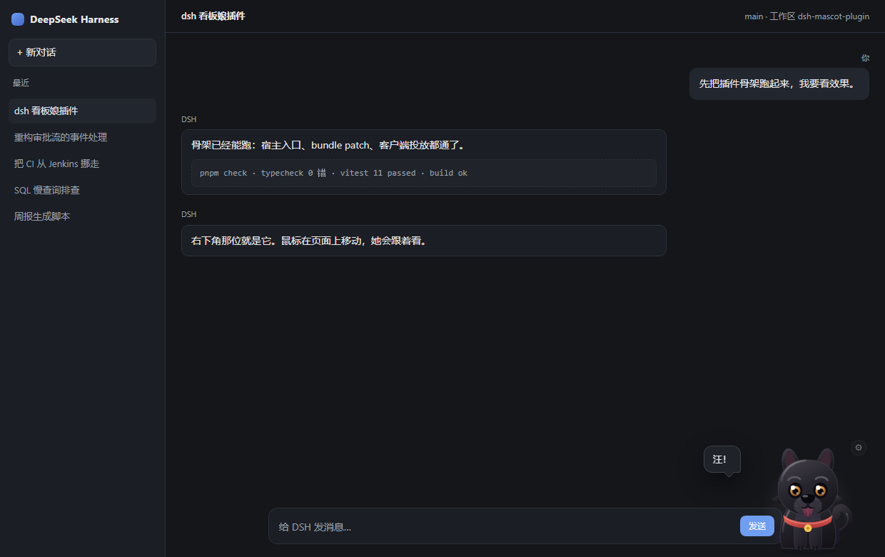
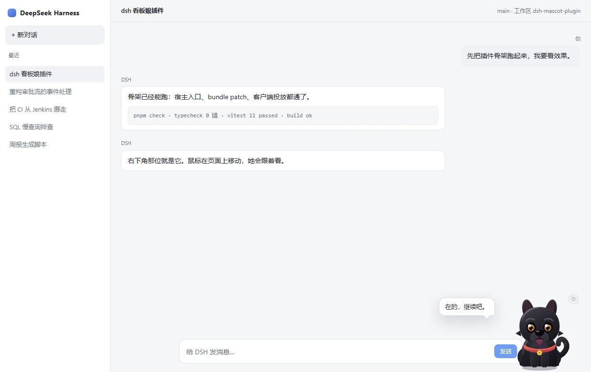
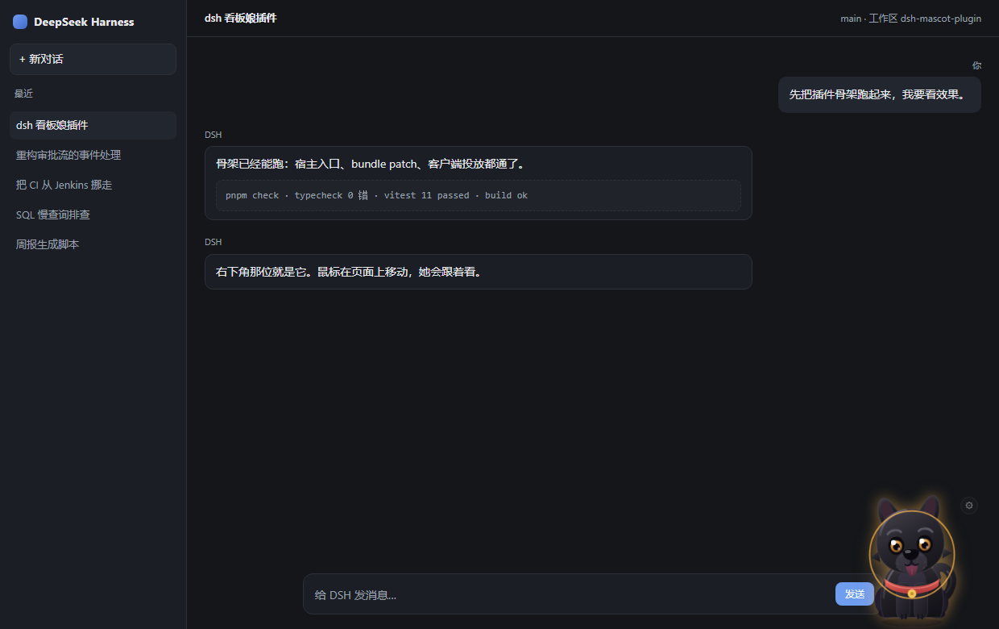
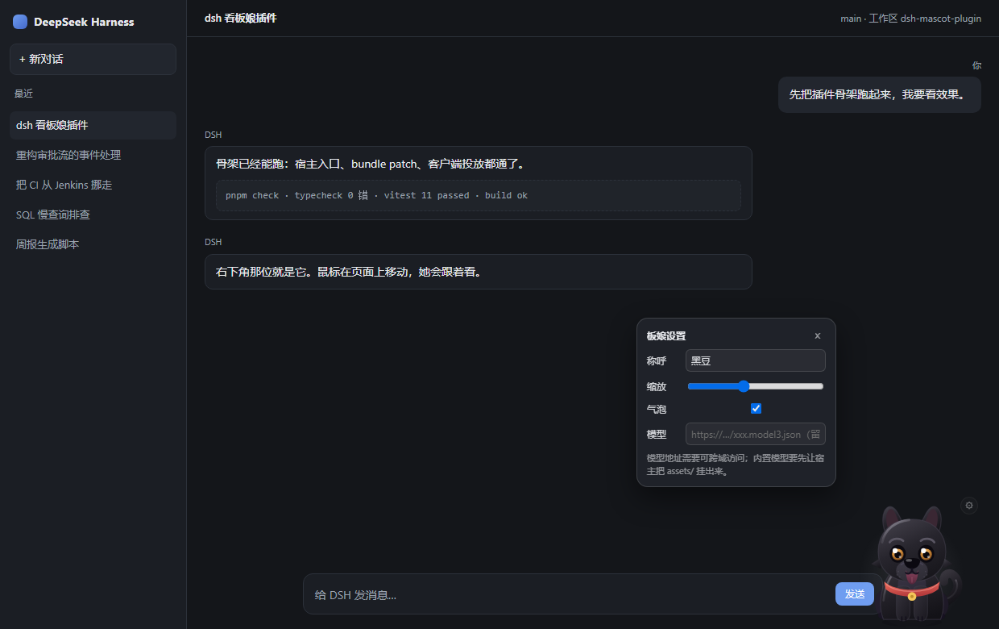

# dsh-mascot-plugin

> 给 DeepSeek Harness（DSH）的 Web 界面养一只看板犬：一只中华五黑犬，全天守在右下角。你写代码它坐着摇尾巴，工具跑起来它跟着忙，等你点「同意」的时候它会一直盯着你。

一个 DSH 双半场插件（host + client），装完右下角就多一只一直在动的狗：坐着、伸懒腰、下犬式、wink、跳两下、趴着打盹，像一张循环 GIF。眼神跟着鼠标走，不依赖任何外部服务。



## 安装

```bash
# 从 npm 安装（发布后可用，也会出现在 DSH 插件中心）
dsh plugin --profile web add dsh-mascot-plugin

# 或者直接从 GitHub 源码安装（不依赖 npm 发布）
dsh plugin --profile web add github:xiongXinYan/dsh-mascot-plugin
```

装完重启 `dsh web`，界面右下角就会出现。卸载：

```bash
dsh plugin --profile web remove dsh-mascot-plugin
```

不想污染日常档案，可以装进一个独立 profile：`--profile plugin-dev`。

## 它到底做了什么

| 你会看到                                                    | 触发条件                    |
| ----------------------------------------------------------- | --------------------------- |
| 右下角一只 Q 版黑狗，呼吸起伏、定时眨眼                     | 装好即出现，无需配置        |
| 坐 → 伸懒腰 → 坐 → 下犬式 → 坐 → wink → 跳 → 打盹，一直循环 | 常驻，不需要触发            |
| 被盯着看：头会转、瞳孔会跟                                  | 鼠标在页面上移动            |
| 点它一下：跳一下、张嘴、冒一句台词                          | 点击角色                    |
| 琥珀色光环 + 暖色描边                                       | 会话在等你审批（`waiting`） |
| 呼吸加快、眨眼变勤                                          | 有工具在跑（`working`）     |
| 闭眼、头顶飘 `zZz`                                          | 5 分钟没有活动（`sleepy`）  |
| 设置面板：称呼 / 缩放 / 气泡开关 / 模型地址                 | 角色右上角的齿轮            |

偏好存在 `localStorage['dsh-mascot:config']`，不写会话日志、不上云。

## 截图

| 深色主题                                    | 浅色主题                                     |
| ------------------------------------------- | -------------------------------------------- |
|  |  |

| 等待你审批（光环脉冲）                          | 设置面板                                         |
| ----------------------------------------------- | ------------------------------------------------ |
|  |  |

截图来自仓库内的本地预览页（`pnpm dev`），不是设计稿。明暗两套配色是插件自己读宿主背景判出来的，不依赖系统偏好。

## 插件信息

| 项       | 值                                                               |
| -------- | ---------------------------------------------------------------- |
| 包名     | `dsh-mascot-plugin`                                              |
| 能力分类 | 界面与体验（偏娱乐向）                                           |
| DSH 版本 | `0.1.x`，web profile（DSH 仍是 developer preview，见下方兼容性） |
| 运行环境 | 浏览器（Chromium / Firefox / Safari 现代版本）；无原生依赖       |
| Node     | `^22.19.0 \|\| >=24.0.0`（只在安装与构建时需要）                 |
| 许可证   | [MIT](./LICENSE)                                                 |
| 仓库     | https://github.com/xiongXinYan/dsh-mascot-plugin                 |

## 权限与风险

装之前你应该知道这些：

- **不联网。** 除了读取插件自带的 `assets/models.json`，以及你在设置面板里手填的 `modelUrl`，不发起任何请求。
- **不碰凭据。** 不读环境变量、不读 `~/.dsh`、不接触工具调用与沙箱。
- **不动宿主 DOM。** 只在自己的浮层锚点里插入节点；监听 `mousemove` 只用来算眼神方向，不拦截、不阻止默认行为。
- **只存两样东西。** `localStorage['dsh-mascot:config']`（称呼、缩放、气泡开关、模型地址）与模型清单缓存。
- **外部输入只有一个。** `modelUrl`，由你自己填写。模型 JSON 里的相对路径以该地址为基准解析——所以**只填你信任的来源**。
- **没有远程代码。** 插件不执行从网络下载的任何脚本；Live2D 运行时如果存在，来自宿主或你自己的页面环境。

## 配置

| 键            | 默认   | 说明                                        |
| ------------- | ------ | ------------------------------------------- |
| `displayName` | `黑豆` | 称呼，出现在 tooltip 与无障碍标签里         |
| `scale`       | `1`    | 缩放，`0.6 ~ 1.6`                           |
| `showBubble`  | `true` | 是否显示对话气泡                            |
| `docked`      | `true` | 是否吸附右下角（自由拖拽待实现）            |
| `modelUrl`    | `''`   | `.model3.json` 地址；空串 = 用内置 SVG 立绘 |

## 兼容性

- **DSH `0.1.x`。** DSH 还在 developer preview，槽位名（`shell.overlay`）与 `dsh.client` 声明都可能变；插件锁的是"槽位 + 客户端入口"这一层最小契约，宿主大改时这里需要跟着调。
- **只做 web profile。** 终端与桌面端没有浮层，装上去不会有效果。
- **不需要 Live2D 也能用。** 内置 SVG 立绘零依赖；要换成 Live2D 模型，需要宿主环境里有 PIXI + Cubism Core，检测不到时会打印 `RUNTIME_MISSING` 并自动回落到 SVG，不会白屏。

## 它是怎么被加载的

```
profile.bundles
  └─ patches/bundle.yaml      → 插入一行 entry：id=ui-mascot, name=dsh-mascot-plugin
       └─ lib/index.js        → 宿主加载 Node 入口（apply(ctx) 目前是空实现，但必须存在）
            └─ package.json 的 dsh.client
                 → Loader 把浏览器半场编进 window.__DSH_BOOT__
                      → 前端拉 /plugins/dsh-mascot-plugin/client.js?rev=<rev>
                           → window.__ModuleLoader__.load({ id, factory }) 懒执行
                                → apply(ctx) → ctx.slots.register('shell.overlay', …)
```

两个容易踩的点：

1. **`lib/index.js` 不能省。** 它不是业务代码，而是"让包成为 Loader entry"的凭证——没有它，`dsh.client` 永远不会被发现，表现是"装成功了但界面上什么都没有"。
2. **`dsh.client.inject` 只写真实存在的行。** 多声明一个不存在的包，这一行会一直等依赖，同样是"静默不出现"。

## 目录结构

```
dsh-mascot-plugin/
├── package.json                # 声明 dsh.bundle.patch 与 dsh.client，导出 apply(ctx)
├── patches/bundle.yaml         # Bundle Patch：插入 ui-mascot 一行
├── lib/
│   ├── index.js                # 宿主端入口（手写，apply(ctx) 在这里）
│   └── client.js               # 浏览器端产物（入库，源码安装时直接可用）
├── src/                        # 客户端源码，构建后拼成 lib/client.js
│   ├── index.js                # 挂载入口、浮层装配、姿态分发
│   ├── character.js            # 内置 SVG 立绘：一只中华五黑犬（分层）
│   ├── acts.js                 # 小动作轮播：坐/伸懒腰/下犬式/wink/跳/打盹
│   ├── look-at.js              # 眼神跟随（CSS 变量 / Cubism 参数两条路）
│   ├── model-loader.js         # 模型清单读取、加载、卸载
│   ├── settings.js             # 设置面板
│   ├── state.js                # 姿态状态机（纯函数，可单测）
│   ├── config.js               # 偏好读写（localStorage 容错）
│   ├── theme.js                # 明暗识别（读宿主背景亮度，不靠系统偏好）
│   ├── styles.js               # 样式表（随 JS 注入）
│   └── types.js                # 共享 JSDoc 类型
├── assets/                     # 模型目录与构建期生成的清单
├── scripts/                    # 构建与本地预览服务器
├── dev/preview.html            # 假 DSH 界面，用桩跑 client.js
├── test/                       # vitest 单测
└── docs/                       # 截图与发布说明
```

## 本地开发

```bash
pnpm install
pnpm dev          # → http://127.0.0.1:5173/ 假 DSH 界面，改 src 自动重建
pnpm check        # typecheck + lint + test + build，提交前跑这一条
```

`pnpm dev` 起的是只监听 `127.0.0.1` 的静态服务，用一份假界面把 `lib/client.js` 跑起来，省掉"改一行 → 重装插件 → 重启 dsh"的循环。左下角控制条可以直接摆姿态、切明暗；地址栏参数更方便截图核对：

```
/?mood=waiting&theme=light&bubble=1&panel=1
/?gaze=0,700&deck=0
/?act=bow&deck=0&zoom=3      # 钉住单个动作放大看，逐张核对姿态
```

装进真实 DSH 里验证：

```bash
dsh plugin --profile plugin-dev add .
dsh --profile plugin-dev --dump-config | grep -i mascot   # 确认 ui-mascot 已插入
dsh --profile plugin-dev
```

### 技术选型：为什么是 JavaScript + JSDoc

DSH 的插件不是原生扩展，宿主只加载 JS 模块，可选范围很窄：

| 候选                                     | 结论    | 理由                                                                                             |
| ---------------------------------------- | ------- | ------------------------------------------------------------------------------------------------ |
| **JavaScript + JSDoc + `tsc --checkJs`** | ✅ 采用 | 源码保持 `.js`，`lib/client.js` 直接拼装投放；类型检查照跑（`pnpm typecheck`），编辑器补全不缺。 |
| TypeScript                               | 可切    | 类型更顺手，但要多一层产物与 sourcemap 处理。骨架阶段收益不抵成本，随时可迁移。                  |
| 纯 JavaScript 无类型                     | ❌      | `inject` 声明、槽位契约、模型参数名写错**不报错、只是没反应**，没有类型检查极难查。              |
| Rust / Go / C++                          | ❌      | 宿主没有原生 ABI。为一个浮层付 subprocess 的代价不值。                                           |
| 前端框架（Vue/Svelte）                   | ❌      | 槽位由宿主的 React 渲染，多引一套框架等于把运行时塞进插件包。                                    |

构建用 **esbuild**：一次调用产出 CJS 并套上 `__ModuleLoader__` 外壳，秒级完成。

## 姿态是怎么来的

姿态入口是一个自定义事件，宿主（或任意脚本）推 `SessionSignal` 进来即可：

```js
window.dispatchEvent(
  new CustomEvent('dsh-mascot:signal', {
    detail: { running: true, awaitingApproval: false },
  }),
)
```

`resolveMood()` 把信号归一成姿态，优先级：审批 > 干活 > 打盹。等接上 DSH 原生会话事件流，只要把"手动派发"换成"订阅"，其余不变。

眼神跟随有两套实现，共用同一套坐标换算（`toGaze`，有单测）：SVG 立绘写 `--gaze-x/--gaze-y` 交给 CSS；Live2D 写 `ParamAngleX/Y`、`ParamEyeBallX/Y`。

### 动作是怎么循环的

立绘只有一张，但要看起来像动图，靠的是两层：

1. **姿态层**（`acts.js`）：`sit / stretch / bow / wink / jump / nap / alert` 七个状态，每个状态在 CSS 里就是一组变量——`--p-root`、`--p-head`、`--p-ear-l`…切 `data-act` 就是在换这组值，浏览器负责插值过渡。
2. **环境层**（CSS 关键帧）：呼吸、眨眼、摇尾、头部微晃。这些和姿态互不干扰，所以任何姿态下都是"活的"。

节拍是"每个动作之前先回坐姿"，就像狗真的起身做个动作再坐回去：

```
sit → stretch → sit → bow → sit → wink → jump → sit → nap → sit → …
```

情绪只决定**允许出现哪些动作**：`working` 只挑伸懒腰/wink/下犬式并加快节奏，`waiting` 钉在 `alert`（抬头竖耳），`sleepy` 钉在 `nap`。钉住的状态不参与轮播，测试里把定时器换成假时钟逐条断言过。

为什么用变量而不是给每个动作写一套 `@keyframes`：六个动作 × 七个部位 = 42 段关键帧，改一处要同步改六处。用变量的话，"趴下"只是把 `--p-root` 换成另一串 transform。

## 已知限制

- **内置模型还取不到。** Loader 只投放 `client.js`，不会自动把 `assets/` 变成静态资源。所以现在要么用内置 SVG 立绘，要么在设置面板里填一个可跨域访问的 `.model3.json` 地址。
- **DSH Web 不带 PIXI / Cubism 运行时。** Live2D 通路要真正跑起来，还需要把运行时挂到 `window.PIXI` 上。
- **不能拖拽。** 目前固定在右下角，`docked` 开关只是占位。
- **没有接会话事件流。** 姿态目前靠手动派发事件，宿主侧订阅还在路线图第 1 项。

## 路线图

1. 接会话事件流：工具开跑 → `working`，弹审批 → `waiting`，久无动静 → `sleepy`（事件入口已就绪，缺订阅）。
2. 宿主侧静态服务：让 `assets/` 随包分发，模型开箱即用。
3. 拖拽 + 边缘吸附 + 位置记忆。
4. 设置面板迁进 DSH 设置页的 `settings.section` 槽。
5. 立绘表情细分与台词库 `assets/lines.json`。

## 贡献

见 [CONTRIBUTING.md](./CONTRIBUTING.md)。提 PR 前请先跑 `pnpm check`；改了 `src/` 记得把 `lib/client.js` 一起提交（CI 会核对产物与源码是否一致）。

## 许可

[MIT](./LICENSE)。内置立绘为本项目自绘；若引入第三方模型，授权与来源写在 `assets/mascot/CREDITS.md`。

---

<sub>English: A mascot companion for the DeepSeek Harness web UI — sits in the bottom-right corner, follows your cursor with her eyes, and changes pose with the session state (idle / working / awaiting approval / sleepy). No network calls, no credentials, settings stored locally. Install with `dsh plugin --profile web add dsh-mascot-plugin`.</sub>
